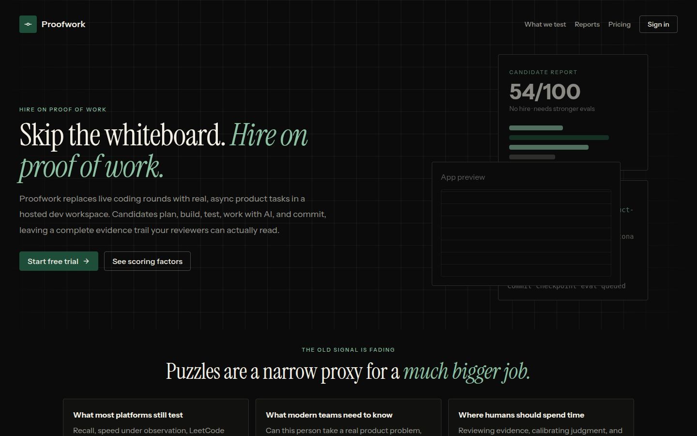
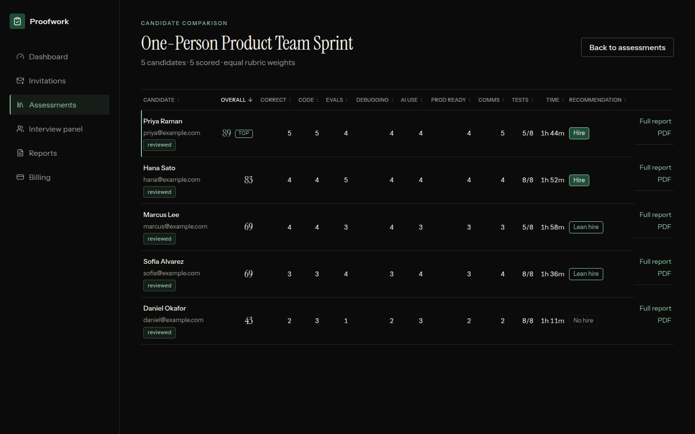

# Proofwork

**Hire on proof of work.** Proofwork is an AI-native hiring assessment platform. Instead of trivia-heavy live coding, an employer turns a job description into a realistic work trial, invites candidates, and each candidate works in a hosted dev box with an AI coding agent and a live app preview. When they submit, Proofwork collects the evidence (diff, tests, commit history, agent logs, proctoring events) and an LLM evaluator turns it into a scored, reviewable PDF report.





## Features

- **Assessment generation from a JD.** Paste or upload a job description (PDF/DOCX) or a project brief; an LLM drafts a role-specific task, definition of done, evaluation plan and starter repo. Templates are saved and reusable.
- **Generated or GitHub-backed starter code.** Ship the bundled `task-template/` starter or point an assessment at an existing repository.
- **Invite-only candidate links** with expiry, resend/cancel, and per-invite proctoring settings.
- **Hosted candidate workspace.** A Daytona dev box is provisioned per attempt (optionally from a warm pool): repo cloned, dependencies installed, app server on port 3000, OpenCode CLI in a browser terminal, OpenCode Web as fallback.
- **Candidate surface.** Task brief, timer, terminal, app preview with restart, optional camera/screen proctoring, and submission.
- **Evidence-based evaluation.** Diffs, test output, commit checkpoints, agent prompts and proctoring recordings are collected and scored on seven criteria by deterministic signals plus an LLM evaluator, with score caps when evidence is missing.
- **Custom scoring rubric (new).** Employers set how much each criterion counts (correctness, code quality, testing, communication/commits, debugging, AI collaboration, production readiness). Weights must sum to 100% and are stored per assessment; the overall score, hire recommendation and PDF report use them. Assessments without custom weights keep the original equal weighting, so old scores do not change.
- **Candidate comparison view (new).** For any assessment, a sortable table of every candidate: overall score, per-criterion scores, tests passed, time taken and hire recommendation, with a link to each full report.
- **PDF reports** (PDFKit) with rubric breakdown, test/eval evidence, commit and prompt-quality signals and proctoring events, emailed through Resend. Reviewers can override scores and leave notes.
- **Human interview loop.** Interviewer availability, candidate slot booking, calendar invites, structured feedback and transcript logging.
- **Billing scaffolding.** Assessment credits with Razorpay order, verification and webhook routes.

## Architecture

```text
            Employer (Clerk auth)                         Candidate (magic link)
                    |                                              |
                    v                                              v
   +----------------------------------+          +-------------------------------+
   |  Next.js App Router (TypeScript) |          |  /assessment/[token]          |
   |  /admin  dashboard, templates,   |          |  brief, timer, terminal,      |
   |          rubric, comparison,     |          |  preview, proctoring, submit  |
   |          reports, interviews     |          +---------------+---------------+
   +----------------+-----------------+                          |
                    |  API routes (/api/admin, /api/candidate)   |
                    v                                            v
   +-----------------------------------------------------------------------------+
   |  Domain layer (app/lib)                                                      |
   |  assessment generator --> LLM (JD -> task, evals, starter repo)              |
   |  workspace provider  --> Daytona dev box  | Fake provider (local dev)        |
   |  job runner (Inngest / local jobs): provision -> timeout -> evaluate         |
   |  evaluator: artifacts -> signals -> LLM judge -> 7 criteria -> weighted score|
   |  reports: PDFKit report -> Resend email   | storage: local FS or S3/R2       |
   +-------------------------------+---------------------------------------------+
                                   |
                                   v
                       PostgreSQL via Prisma
     (organizations, templates + scoring weights, invitations, attempts,
      artifacts, eval runs, scorecards, interview bookings)
```

Candidate workspace lifecycle:

1. Employer sends an invite; the candidate opens the link (proctoring checks first, if enabled).
2. A workspace is provisioned and the repo is prepared with `README.md`, `TASK.md`, `EVALS.md`, OpenCode config and a baseline commit.
3. The candidate works with OpenCode CLI in the browser terminal; commit hooks capture checkpoints.
4. On submit or timeout, artifacts are collected, scored with the assessment's rubric weights, and a report is generated.

## Stack

- Next.js 15 (App Router), React 19, TypeScript
- Prisma + PostgreSQL
- Clerk (employer auth, optional locally)
- Daytona (candidate dev boxes) and OpenCode CLI/Web (AI coding agent)
- DeepSeek for the candidate coding agent, OpenAI GPT models for generation and evaluation
- Inngest for background jobs (with an in-process fallback)
- PDFKit (reports), Resend (email), S3-compatible storage for recordings
- Razorpay (payments)
- Node test runner (`node:test`) via tsx

## Repository layout

```text
app/
  admin/                    Employer dashboard (templates, comparison, reports, ...)
  api/                      Admin, candidate, billing, proctoring, interview APIs
  assessment/[token]/       Candidate assessment page
  components/               Shared UI and workflow components
  lib/
    domain/                 Pure logic: scoring, rubric weights, invites, time
    comparison.ts           Candidate comparison rows and sorting
    evals/                  Evidence signals + LLM evaluator
    workspaces/             Daytona and fake workspace providers, warm pool
    reports/                PDF report generation
  styles/                   Feature stylesheets inlined after globals.css
prisma/schema.prisma        Data model
docker/sandbox/             Optional pre-baked workspace image
task-template/              Starter repo uploaded into candidate workspaces
scripts/                    E2E and maintenance scripts
tests/                      Node test suite
```

## Local setup (no Daytona, no Clerk)

Requirements: Node 20+, Docker (for Postgres).

```bash
npm install
cp .env.example .env            # fill in only what you need
docker compose up -d postgres   # Postgres on localhost:5433
npx prisma generate
npm run db:push                 # sync the schema
WORKSPACE_PROVIDER=fake npm run dev -- --port 3001
```

Open http://localhost:3001.

- With `WORKSPACE_PROVIDER=fake` (or no `DAYTONA_API_KEY`) the app uses the fake workspace provider: attempts get placeholder terminal/preview URLs, so you can walk through invites, the candidate page, submission and reports without any cloud workspace.
- Without Clerk keys the admin area runs in single-admin mode with a local default organization.
- Without an OpenAI key, assessment generation and evaluation fall back to the built-in deterministic generator and heuristic scorer.

For the real flow, set `DAYTONA_API_KEY`, `DAYTONA_ORGANIZATION_ID`, `DEEPSEEK_API_KEY`, `OPENAI_API_KEY`, `RESEND_API_KEY`, `INVITE_EMAIL_FROM` and the Clerk keys. See `.env.example` and `app/lib/env.ts` for the full list.

## Scripts

```bash
npm test             # unit/domain tests (node:test)
npx tsc --noEmit     # type check
npm run build        # prisma generate + next build
```

## Design notes

Assessments test modern product-engineering work rather than puzzles: understanding an ambiguous brief, scoping, using AI agents with judgment, shipping, writing meaningful tests, debugging, and communicating trade-offs. Hidden eval material stays outside the candidate-visible repo, and candidate workspaces only receive scoped model credentials.
